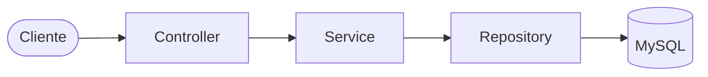
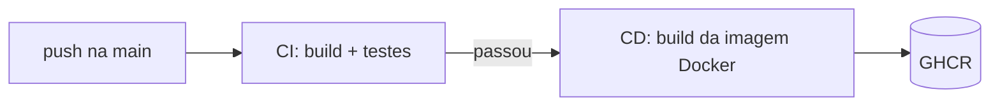

<h1 align="center">📦 Sistema de Estoque</h1>

<p align="center">
  API REST para controle de estoque de produtos, com testes automatizados,<br>
  Docker, pipeline CI/CD e infraestrutura como código.
</p>

<p align="center">
  <a href="https://github.com/GelitonFilhodev/sistema-estoque-java-spring-boot/actions/workflows/ci.yml">
    
  </a>
</p>

<p align="center">
  
  
  
  
  
  
</p>

---

## 📑 Sumário

- [✨ Funcionalidades](#-funcionalidades)
- [🏗️ Arquitetura](#️-arquitetura)
- [🚀 Como rodar](#-como-rodar)
- [📡 Endpoints](#-endpoints)
- [🧪 Testes](#-testes)
- [⚙️ CI/CD](#️-cicd)
- [🌍 Terraform](#-terraform)
- [🔐 Variáveis de ambiente](#-variáveis-de-ambiente)
- [👤 Autor](#-autor)

## ✨ Funcionalidades

- ✅ CRUD completo de produtos (nome, descrição, preço e quantidade)
- ✅ Tratamento global de erros (404 quando o produto não existe)
- ✅ Testes unitários com Mockito e testes de contexto com H2
- ✅ Aplicação e banco containerizados com Docker Compose
- ✅ Pipeline de CI (testes) e CD (publicação da imagem no GHCR)
- ✅ Infraestrutura descrita com Terraform

## 🏗️ Arquitetura

Arquitetura em camadas: cada camada só conversa com a de baixo.



```
src/main/java/com/estoque/estoque
├── controller    # recebe as requisições HTTP
├── service       # regras de negócio
├── repository    # acesso ao banco (Spring Data JPA)
├── model         # entidades (Produto)
└── exception     # exceções e tratamento global de erros
```

## 🚀 Como rodar

### 🐳 Com Docker (recomendado)

```bash
git clone https://github.com/GelitonFilhodev/sistema-estoque-java-spring-boot.git
cd sistema-estoque-java-spring-boot
cp .env.example .env
```

Edite o `.env` e preencha `DB_PASSWORD`. Depois:

```bash
docker compose up -d --build
```

| Serviço | Endereço |
|---|---|
| API | http://localhost:8080 |
| MySQL (DBeaver, Workbench...) | `localhost:3307` |

Para parar tudo: `docker compose down`

### 💻 Sem Docker

Precisa de um MySQL local com o banco `estoque` criado.

```bash
export DB_USER=root
export DB_PASSWORD=sua_senha
./mvnw spring-boot:run
```

## 📡 Endpoints

| Método | Rota | Descrição |
|---|---|---|
| 🟢 `GET` | `/produtos` | Lista todos os produtos |
| 🟢 `GET` | `/produtos/{id}` | Busca um produto (404 se não existir) |
| 🔵 `POST` | `/produtos` | Cria um produto |
| 🟡 `PUT` | `/produtos` | Atualiza um produto (o `id` vai no corpo) |
| 🔴 `DELETE` | `/produtos/{id}` | Remove um produto |

**Exemplo de corpo (POST):**

```json
{
  "nome": "Teclado",
  "descricao": "Teclado mecanico",
  "preco": 150.00,
  "quantidade": 10
}
```

```bash
curl -X POST http://localhost:8080/produtos \
  -H "Content-Type: application/json" \
  -d '{"nome":"Teclado","descricao":"Teclado mecanico","preco":150.00,"quantidade":10}'
```

## 🧪 Testes

```bash
./mvnw test
```

Os testes do service usam **Mockito** (repository simulado) e os testes de contexto usam **H2 em memória**, então não precisam de MySQL nem de senha.

## ⚙️ CI/CD



| Workflow | Arquivo | O que faz |
|---|---|---|
| **CI** | `.github/workflows/ci.yml` | Compila e roda os testes a cada push na `main` e em pull requests |
| **CD** | `.github/workflows/cd.yml` | Quando o CI passa na `main`, builda a imagem e publica no GitHub Container Registry |

Imagem publicada:

```
ghcr.io/gelitonfilhodev/sistema-estoque-java-spring-boot:latest
```

## 🌍 Terraform

A pasta `terraform/` cria a rede, o volume, o MySQL e a API como containers Docker.

```bash
cd terraform
export TF_VAR_db_password=sua_senha
terraform init
terraform plan
terraform apply
```

Para remover tudo: `terraform destroy`

> ⚠️ O Terraform e o Docker Compose usam as mesmas portas (8080 e 3307), então não rodam ao mesmo tempo.

## 🔐 Variáveis de ambiente

| Variável | Descrição |
|---|---|
| `DB_USER` | Usuário do MySQL |
| `DB_PASSWORD` | Senha do MySQL |

Os valores reais ficam no `.env`, que não vai pro git. O `.env.example` é só um modelo.

## 👤 Autor

Feito por **Geliton Filho**.

[](https://github.com/GelitonFilhodev)
